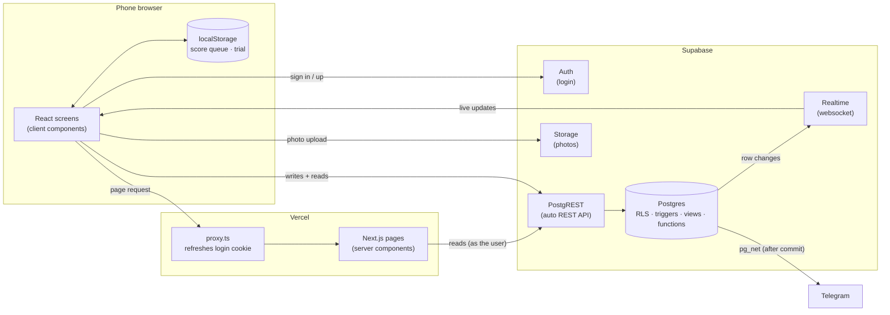
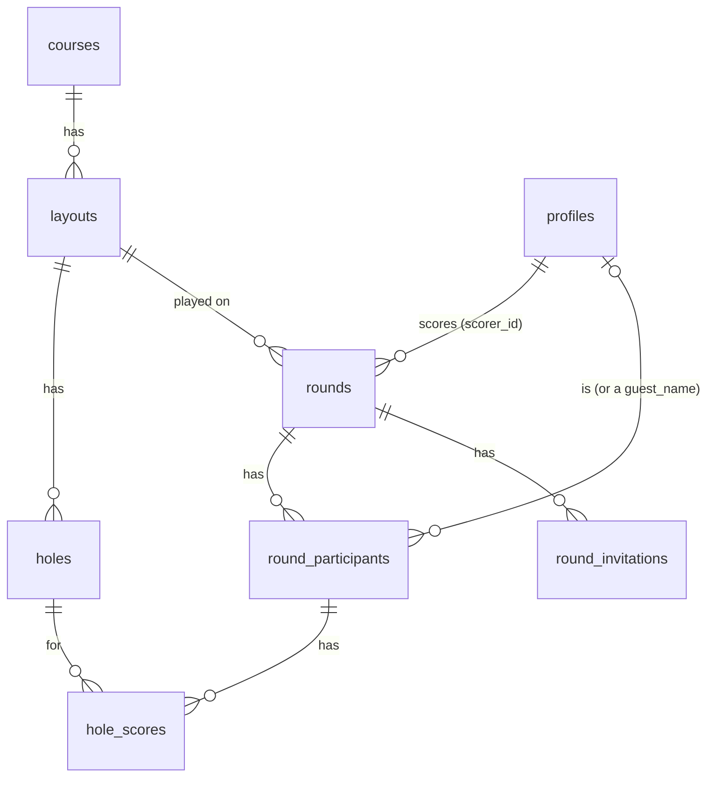
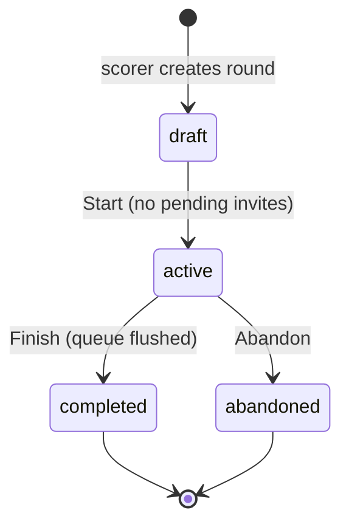
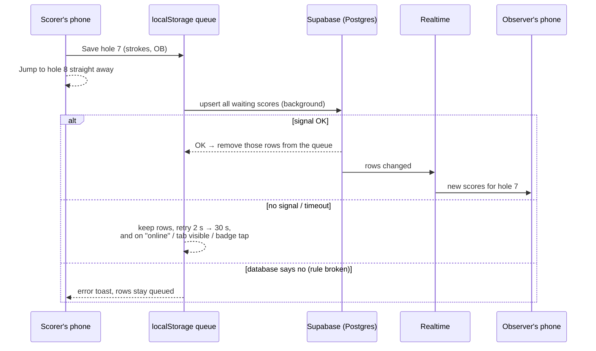

# Discore — Architecture

> How the pieces fit together and why they were built this way. The rules themselves live in [BLUEPRINT.md](BLUEPRINT.md); current state and roadmap in [STATUS.md](STATUS.md). This file explains; if it ever disagrees with the code or the migrations, they win, so fix this file.

---

## 1. The big picture

Discore has three moving parts: the **phone's browser**, a **Next.js app on Vercel**, and **Supabase** (a hosted Postgres database plus login, file storage and live updates).

What each arrow means in plain words:

- **Opening a page.** The browser asks Vercel for a page. `proxy.ts` runs first and refreshes the login cookie if needed. Then a **server component** (React code that runs on Vercel, not the phone) loads the data for that page from Supabase and sends finished HTML to the phone. Example: `app/rounds/[roundId]/page.tsx` loads the round, players, holes and scores.
- **Doing something** (saving a score, inviting a friend, starting a round). The **client component** on the phone talks to Supabase **directly** through PostgREST, a ready-made REST API that Supabase puts in front of Postgres. There is no custom backend server in between: Vercel serves pages; it does not relay writes.
- **Watching live.** Supabase Realtime keeps a websocket open to the phone and pushes a message whenever a row the user may see changes. That is how observers see scores appear.
- **The database sends messages on its own.** One trigger uses `pg_net` to call Telegram when a course suggestion arrives (§4.8).

Because the phone talks to the database directly, **the database is the only place that can say "no"**. That is the single most important idea in this codebase (§4.2).

### Two Supabase clients

Code that runs on Vercel uses `lib/supabase/server.ts`; code that runs on the phone uses `lib/supabase/client.ts`. Both act **as the signed-in user** (the login cookie travels with every request), so the same database rules apply either way. They are kept apart because they read the login from different places — mixing them up gives silent "no rows" bugs (BLUEPRINT §4).

### Where things live

| Thing | Where |
|---|---|
| Screens | `app/` (one folder per route) |
| Shared UI | `components/` |
| Logic shared by screens, scoring math | `lib/` (`lib/scoring` is pure, tested TypeScript) |
| Schema, rules, functions | `supabase/migrations/` (one SQL file per change, never edited after it runs) |
| Database tests | `supabase/tests/` (pgTAP) |
| Course data | `supabase/seeds/courses/*.json` |

---

## 2. The data, in one picture

- **Catalog** (`courses` → `layouts` → `holes`): public, read-only, filled from git (§4.4).
- **A round**: one layout, one scorer, a status. Players are `round_participants` — either a registered user or just a `guest_name`.
- **Scores**: one `hole_scores` row per player per hole. Each row stores the par it was played at (§4.5).
- **Stats** are Postgres **views** (saved queries such as `player_round_stats`) so the phone gets finished numbers instead of thousands of raw scores.

---

## 3. Life of a round

A round moves through four states. A database trigger only allows these arrows — there is no way back, and nothing can skip ahead.

### 3.1 Draft — setting up the card

The scorer picks a layout (`/rounds/new`) and lands on the round page in **draft**. Here they:

- add **guests** by name → a `round_participants` row with `guest_name`;
- **invite** registered friends → a `round_invitations` row. The friend sees it on Home (live, via Realtime) and accepts or declines. Accepting calls the `accept_invite` function, which marks the invite accepted **and** adds them as a participant in one go (§4.6).

The scorer's own screen updates live as friends accept, because it listens to `round_participants` and `round_invitations` changes. **Start** is allowed once no invite is still pending; it sets `status = 'active'` (`lib/rounds/round-draft-actions.ts`). From then on the layout is locked and nobody can join.

### 3.2 Active — scoring a hole

This is the screen that matters most: it must never make the scorer wait, even with no signal.

Step by step:

1. **Save is instant.** The scores go into a queue in `localStorage` (`discore:pending-scores:<roundId>`, `lib/rounds/pending-scores.ts`) and the screen moves to the next hole. No network involved.
2. **Sync happens in the background.** `useScoreSync` (`app/rounds/[roundId]/hooks/use-score-sync.ts`) sends everything waiting as **one upsert** ("insert, or update if that player × hole already exists").
3. **Bad signal → retry.** Timeouts and server hiccups are retried with growing pauses, and immediately when the phone comes back online or the tab is reopened. A small badge shows "not synced yet"; it is hidden when all is saved.
4. **Rule broken → stop.** If the database refuses (for example, the round is no longer active), retrying would not help, so the app shows an error and keeps the scores.
5. **The screen trusts the phone.** What you see is server rows with queued values laid on top (`overlayPendingScores`). So a late echo from the server can never flash an older number.
6. **Reloading is safe.** The queue survives a reload and picks up where it left off.

Before a row is stored, the database checks it: is this user the round's scorer, is the round active, does this player and this hole belong to this round, are strokes 1–25? It also stamps the hole's current par onto the row.

### 3.3 Observers — watching live

Registered players on the card who are not scoring are **observers**. They open the same round page, but read-only. `useRoundRealtime` (`app/rounds/[roundId]/hooks/use-round-realtime.ts`) subscribes to four tables, filtered to this round:

| Table | Why |
|---|---|
| `hole_scores` | new scores appear as they land |
| `rounds` | status changes (started, finished) |
| `round_participants`, `round_invitations` | who is on the card (mostly in draft) |

Realtime only sends rows the user is **allowed to read** (it uses the same RLS rules), so nobody can listen in on a round they are not part of. Websockets drop on mobile data, so the page also **reloads everything** when the subscription (re)connects and when the tab becomes visible again. If the scorer is in a dead spot, observers simply see the scores a bit later, when the scorer's phone syncs.

Guests have no phone presence; they just appear on the scorecard.

### 3.4 Finishing

- **Finish** needs signal: the app first flushes the queue; if that fails, the round stays active with a "saved on this phone" message, so no score is ever lost. Then it sets `status = 'completed'` and `completed_at`.
- **Abandon** sets `status = 'abandoned'` and throws away the queue.
- A finished round shows the scorecard, results and a one-time insights card. From now on its scores count in stats views.

### 3.5 The trial (signed out)

A visitor can score a round without an account (`/rounds/trial`). Everything lives in `localStorage` (`discore:local-trial`) — the database never sees it. When they sign in or sign up, a **completed** trial is sent to the `claim_trial` function, which creates the round, the guests and every score in one transaction. See §4.3.

---

## 4. Decision records

Short records of the choices that shape the code: what we decided, why, and what it costs. Format: **Decision · Why · Trade-off**.

### 4.1 One scorer per round

- **Decision.** Each round has exactly one `scorer_id`, the person who created it. Only they write scores; everyone else on the card watches.
- **Why.** That is how disc golf is played — one person keeps the card. It also makes sync simple: with one writer there are no conflicts to merge, so "the latest value per player × hole" is always correct, and re-sending is harmless.
- **Trade-off.** If the scorer's phone dies, nobody else can take over the card. Accepted: it is rare, and multi-writer sync is a lot of complexity for a casual app.

### 4.2 Row Level Security is the authorization

- **Decision.** The phone writes straight to the database. All access rules are **RLS policies** (rules on each table: "a user may update this row only if …") and **triggers** (code that runs on every insert/update and can reject it). There are no API routes that check permissions.
- **Why.** The publishable Supabase key is public — anyone can call the API with it. So the checks have to sit in the one place nobody can skip: the database. One set of rules covers the app, the API and Realtime alike, and there is no second backend to keep in sync.
- **How it is kept honest.** Every policy, trigger or function change ships with **pgTAP tests** (`supabase/tests/`, run in CI) that sign in as different users and check what they can and cannot do.
- **Trade-off.** Rules are written in SQL, which is harder to read than TypeScript, and mistakes are silent ("no rows") rather than loud. The tests are the safety net.

### 4.3 Local trial, claimed on sign-in

- **Decision.** Signed-out players score in `localStorage`. Only a **completed** trial is saved, by `claim_trial`, when they sign in. In-progress or broken trials are dropped at that point.
- **Why.** Trying the app should take zero steps — no account, no database rows for strangers. Anonymous visitors have no write access to any table, which keeps the database clean and safe.
- **Safe to repeat.** Each trial has a random `claimId`; the round stores it as `guest_claim_id`. If the claim runs twice (double tap, reload, slow network), the second call just returns the round already saved.
- **Trade-off.** A trial lives on one phone and is lost if the browser storage is cleared. The trial screen (`app/rounds/trial/trial-session.tsx`) also duplicates much of the signed-in scoring UI (listed under debts in STATUS).

### 4.4 Course data lives in git, as JSON

- **Decision.** Every layout is one JSON file in `supabase/seeds/courses/`. A script (`scripts/seed-courses.ts --new-migration`) turns changed files into a migration; the database is never edited by hand. CI fails if JSON changes without a matching migration.
- **Why.** Course data has history: the git log shows who changed which par, when, and why, and every change is reviewed in a PR. Local, CI and production databases all get the same data by replaying migrations. Users suggest fixes in the app (`/courses/suggest`); the owner applies them to the JSON.
- **Trade-off.** Fixing a typo needs a PR and a `db push`, not a click in a dashboard. Holes or layouts that have scores cannot be deleted — they are retired with `is_active: false`.

### 4.5 Each score keeps its own par

- **Decision.** `hole_scores.par` stores the par **at the time the hole was played**. The database fills it in on insert (the phone cannot choose it). All stats use this column, never `holes.par`.
- **Why.** Pars change when a course is re-set or corrected. Without a snapshot, fixing a par would silently rewrite every old round's score, birdies and aces.
- **Trade-off.** A little duplicated data, and every stats query must remember to use the right column.

### 4.6 Multi-step writes are database functions

- **Decision.** Writes that must all succeed or all fail run as one Postgres function called via RPC: `claim_trial` (round + guests + scores) and `accept_invite` (accept + join).
- **Why.** The browser cannot open a transaction — each API call commits on its own. A dropped connection halfway could leave a round with no scores, or an accepted invite with no player. Inside one function, Postgres runs everything as a **transaction**: all of it is saved or none of it.
- **Still safe.** The functions are `SECURITY INVOKER`: they run as the calling user, so the RLS rules and triggers from §4.2 still decide what is allowed. They only bundle steps, they do not grant extra power.
- **Trade-off.** The logic is in SQL, and each function needs its own tests. Use this only when steps truly belong together; single writes stay plain API calls.

### 4.7 The score queue (save first, sync later)

- **Decision.** Saving a hole writes to a local queue and returns immediately; a background loop sends the queue to the database (§3.2).
- **Why.** Courses have dead spots. The core promise is "scoring never makes you wait", so the network cannot be in the save path.
- **Why it is simple.** Thanks to the single scorer (§4.1) and upsert on player × hole, the queue holds only the newest value per cell, not a list of events. Re-sending is always harmless, so the retry logic does not need to track what was "already sent".
- **Trade-off.** Scores only sync while the round page is open (no service worker yet), the page needs signal to **load**, and finishing needs signal. Accepted for now; a fully offline app is a later step if it is needed.

### 4.8 Telegram ping from the database (pg_net)

- **Decision.** When a course suggestion is inserted, a trigger calls the Telegram API with `pg_net` to message the owner. The bot token and chat id are stored in **Supabase Vault** (encrypted secrets inside the database).
- **Why.** Suggestions are written browser → database, so there is no server code that could send a message. A trigger fires on every insert no matter where it came from. `pg_net` is **asynchronous**: the request is queued and sent after the insert has committed, so a slow or broken Telegram can never slow down or fail a suggestion.
- **Safe defaults.** With no secrets in Vault (local, CI) the trigger does nothing. Any error is logged as a warning and the suggestion is kept. No secret is ever in git.
- **Trade-off.** If the ping fails, nobody retries it — fine, because the review page (`/admin/suggestions`) is the real inbox; the ping is only a nudge.

---

## 5. How a change is checked

Every PR runs three CI jobs (GitHub Actions), and `main` only accepts a PR when all pass:

| Job | What it proves |
|---|---|
| `check` | types, lint, unit tests (`lib/scoring` and friends), course JSON has a seed migration, the app builds |
| `database` | all migrations replay from scratch; pgTAP tests prove the RLS rules and triggers |
| `e2e` | Playwright clicks through real flows (sign in, score a round, …) against a local Supabase |

Then the owner tries the **Vercel preview** of the PR on a phone, and it is merged. Migrations are pushed to production by the owner (`npx supabase db push`) — before testing the preview when the app code depends on them, since previews use the production database.
